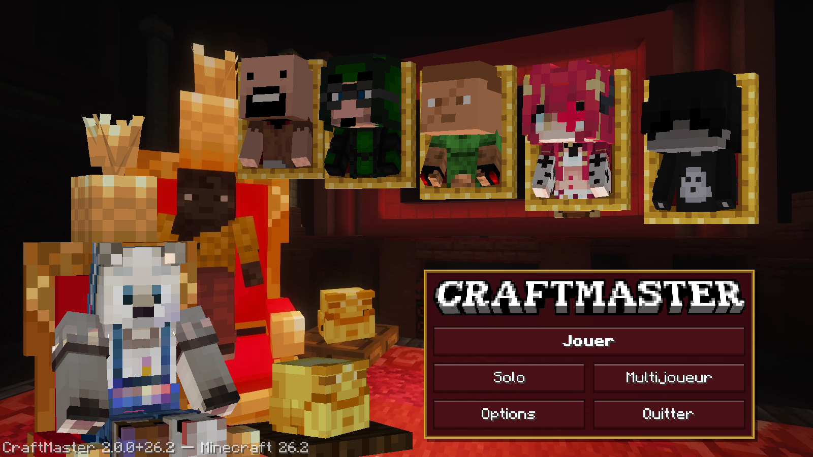
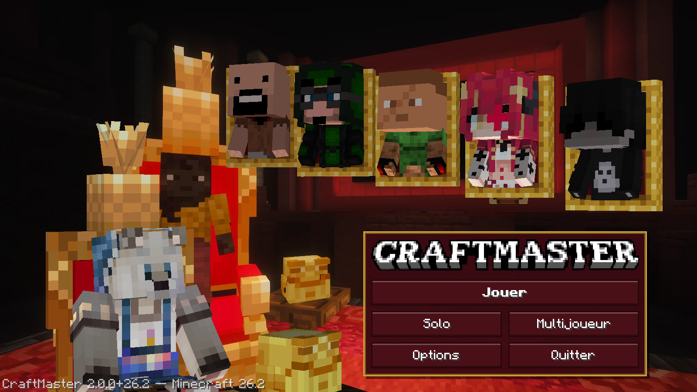
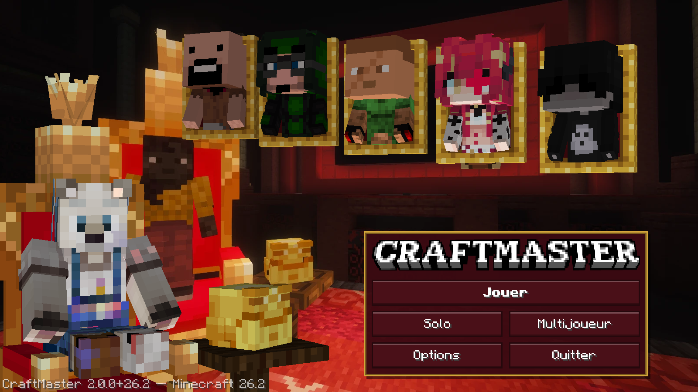

# Écran d'accueil

Au lancement du jeu (côté joueur), l'écran titre de Minecraft est remplacé par celui de CraftMaster :

- en fond, une image du plateau (agrandie juste ce qu'il faut pour que la parallaxe n'en montre jamais les bords) ;
- à gauche, **LordFinn assis sur le trône** du plateau, en 3D, avec son skin, qui respire et regarde un peu
  autour de lui (et vers la souris) ; le trône est coupé par le bas de l'écran. À côté, une **table avec la
  Grenouille d'or** (la table basse en épicéa de Macaw's Furniture si le mod est installé, sinon un guéridon) ;
- en haut, **les tableaux des joueurs**, dessinés exactement comme les tableaux suspendus du mod : une rangée vue
  en perspective légère, le joueur 1 le plus près (en haut à droite), la rangée fuyant vers LordFinn, chaque cadre
  tourné de trois quarts vers lui et balançant doucement ; les plus lointains se fondent un peu dans le fond ;
- en bas à droite, un **panneau fixe** (velours et liseré doré) avec le logo CraftMaster et les boutons :
  **Jouer** (connexion directe au serveur de l'émission), Solo, Multijoueur, Options, Quitter. Par défaut il
  s'aligne sur la rangée de tableaux (sans jamais passer sur le trône ni la table).

La souris fait bouger trois plans à des vitesses différentes : le fond lentement, les tableaux un peu plus (la
rangée pivote légèrement), LordFinn, le trône et la table le plus vite. Le panneau ne bouge pas.





## Le fichier `config/craftmaster/accueil.json`

Créé avec les réglages par défaut au premier lancement (dans le dossier `config/craftmaster/` du jeu, pas du
serveur). Il est **relu à chaque ouverture de l'écran** et en revenant des options : on peut le modifier jeu
lancé, aller dans Options puis revenir pour voir le résultat. Toutes les valeurs sont facultatives (une valeur
absente ou fausse garde sa valeur par défaut). Si le fichier n'est pas du JSON valide, ou si l'écran n'arrive pas à
s'afficher, le jeu montre l'écran titre de Minecraft (et le dit dans les logs, lignes `[Accueil]`).

| Clé | Par défaut | Rôle |
|---|---|---|
| `actif` | `true` | `false` : l'écran titre de Minecraft |
| `serveur` | l'adresse du serveur de l'event | adresse du bouton Jouer (jamais affichée à l'écran) |
| `nomServeur` | `CraftMaster` | nom affiché pendant la connexion |
| `fond` | `""` | image PNG du fond (chemin relatif à `config/craftmaster/`, ou absolu) |
| `zoomFond` | `1.12` | agrandissement du fond (marge pour la parallaxe) |
| `poseParDefaut` | `classique` | pose des tableaux sans pose donnée |

**Changer le fond** : le plus simple est de déposer l'image sous le nom `config/craftmaster/accueil-fond.png` :
elle est prise automatiquement quand `fond` est vide. Sinon, mettre son chemin dans `fond`. N'importe quelle taille
(elle est recadrée pour couvrir l'écran) ; Minecraft ne lit que le PNG (convertir un .webp / .jpg avant).

### `personnage` : LordFinn et son trône

| Clé | Par défaut | Rôle |
|---|---|---|
| `pseudo` | `LordFinn` | skin du joueur (cherché chez Mojang) |
| `skin` | `""` | ou un skin : lien `https://…png` ou fichier PNG (relatif à `config/craftmaster/`), HD accepté |
| `trone` | `true` | dessiner le trône avec lui |
| `taille` | `1.1` | hauteur du trône en part de la hauteur de l'écran (au-dessus de 1 : coupé par les bords) |
| `echelle` | `1.35` | taille de LordFinn par rapport au trône (1 = proportions réelles) |
| `angle` | `20` | le groupe tourné vers la droite (degrés, 0 = face au joueur) |
| `x`, `y` | `0.17`, `0.98` | où il est assis (centre du coussin), en fraction de l'écran (0,0 = en haut à gauche) |

`y` près de 1 met le coussin en bas de l'écran : le bas du trône est hors champ, même quand la souris le fait
monter. Pour agrandir l'ensemble : augmenter `taille` (et redescendre `y` si besoin).

### `table` : la table et la Grenouille d'or

| Clé | Par défaut | Rôle |
|---|---|---|
| `actif` | `true` | montrer la table et la grenouille |
| `bloc` | `mcwfurnitures:spruce_coffee_table` | bloc dessiné comme table (n'importe quel id) ; s'il n'existe pas (mod absent), guéridon en chêne noir |
| `x`, `z` | `1.7`, `0.35` | position en blocs depuis le coussin du trône (x vers la droite, z vers le joueur) |
| `angle` | `0` | rotation de la table (degrés) |
| `angleGrenouille` | `22` | rotation de la grenouille sur la table |
| `echelle` | `1.3` | taille de la table et de la grenouille (1 = proportions réelles à côté du trône) |

La grenouille est une tête de joueur avec la texture de la tête HeadDatabase de l'ancien serveur, téléchargée chez
Mojang comme n'importe quelle tête. Sans connexion, la copie `assets/craftmaster/textures/entity/golden_frog.png`
du mod est utilisée si elle est présente ; sinon la grenouille n'est pas dessinée.

### `joueurs` : les tableaux

Une liste, le premier est le plus près (en haut à droite). Chaque entrée est un pseudo, ou un objet :

```json
"joueurs": [
  "Ensuri",
  { "pseudo": "Cyllu", "pose": "salut" },
  { "pseudo": "Juste", "skin": "skins/juste.png" },
  { "pseudo": "Arreaubaz", "skin": "https://exemple.fr/skin.png" }
]
```

- `skin` : comme pour le personnage (lien ou fichier PNG, skins HD acceptés). Sans skin, celui du pseudo.
- `pose` : une des poses prédéfinies des tableaux (`classique`, `sort du cadre`, `assis dans le cadre`,
  `porte le cadre`, `se penche dehors`, `salut`, `bras croisés`, `trône`, `sort par derrière`), voir
  [Tableaux](Tableaux.md).

Si Mojang refuse les recherches de skins (trop de demandes), les tableaux portent le skin par défaut ; ils
prennent les vrais skins dès que Mojang répond, sans bloquer l'écran.

### `cadres` : la rangée de tableaux

| Clé | Par défaut | Rôle |
|---|---|---|
| `max` | `5` | nombre de tableaux montrés au plus |
| `angle` | `18` | rotation de trois quarts vers LordFinn (degrés, vue depuis le joueur) |
| `balancement` | `4` | balancement autour de cet angle (± degrés, chaque cadre son rythme) |
| `ecart` | `1.2` | distance entre deux tableaux, en largeurs de cadre |
| `taille` | `0.32` | hauteur du tableau le plus proche, en part de la hauteur de l'écran |
| `premier` | `[0.86, 0.33]` | centre du tableau 1 (fraction de l'écran) |
| `fuite` | `[0.4, 0.27]` | zone vers laquelle la rangée s'éloigne |
| `plusLoin` | `0.8` | taille du tableau le plus loin par rapport au plus proche |
| `champ` | `24` | champ de vision de la caméra (degrés) : plus petit = perspective plus faible |
| `brume` | `0.35` | voile de la couleur du fond sur le tableau le plus loin (0 = aucun) |

### `panneau` : le logo et les boutons

| Clé | Par défaut | Rôle |
|---|---|---|
| `gauche`, `droite` | `-1`, `-1` | bords du panneau en fraction de l'écran ; `-1` = alignés sur la rangée de tableaux |
| `marge` | `12` | distance au bas de l'écran (pixels d'interface) |
| `interieur` | `6` | marge intérieure |

Le logo remplit la largeur du panneau (net, au pixel près quand c'est possible), les boutons aussi.

### `parallaxe`

| Clé | Par défaut | Rôle |
|---|---|---|
| `fond` | `7` | déplacement du fond (pixels d'interface, souris au bord de l'écran) |
| `cadres` | `13` | déplacement de la rangée de tableaux |
| `devant` | `20` | déplacement de LordFinn, du trône et de la table |
| `pivot` | `3` | rotation de la rangée (degrés) |
| `douceur` | `5` | vitesse à laquelle tout suit la souris (plus grand = plus vif) |

## Pour les développeurs

Code : `client/home/` (écran, scènes 3D en perspective dans l'interface, trône, table), `home/HomeConfig`
(lecture du fichier) et `home/HomeLayout` (calculs testés : rangée en perspective, balancement, recadrage du fond,
lissage, panneau). Les tableaux passent par `PortraitRenderer.menuState` (le même rendu que les tableaux suspendus,
sans crochet ni ficelle). En développement, `dev-input.txt` accepte `screenshot` (capture sans monde ouvert) et
`hover x y` (position de souris pour tester la parallaxe), voir [Tests](Tests.md).
