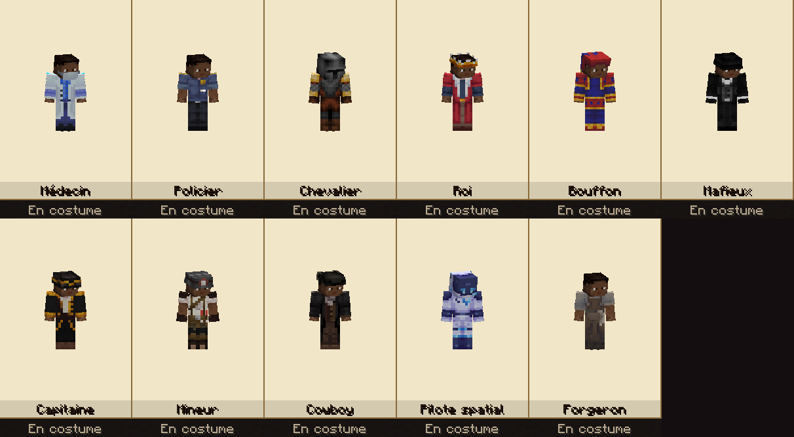

# Garde-robe : changer de tenue en un clic

Pour les épreuves « portez une tenue », « déguisez-vous », un défilé… La **garde-robe** est une armoire en noyer à
filets dorés, deux blocs de haut, avec un miroir sur la porte de droite (onglet créatif CraftMaster, ou planches +
lingot d'or + coffre + vitre). Ses portes s'ouvrent pendant qu'on choisit (on voit les habits pendus).

Une tenue = un nom et quatre pièces (tête, corps, jambes, pieds), portées dans les emplacements d'armure. Elle marche
avec n'importe quelle armure ou tête, et surtout avec les vêtements de **Selfexpression** (mod facultatif du modpack
de l'event, 322 tenues).

## Utiliser

- **Clic droit sur l'armoire** : l'écran des tenues. À gauche, toi habillé de ce qui est sous la souris (la tête
  suit la souris, **glisser** pour le faire tourner) ; à droite les tenues en cartes, molette pour défiler.
- **Clic sur une tenue** : tu l'enfiles en entier. **Clic sur une seule pièce** (l'icône du chapeau, de la
  veste…) : tu n'enfiles qu'elle et tu gardes le reste. On mélange ainsi les tenues (« Tenue mélangée »).
- **Clic droit sur une tenue : favori** (★, encore un clic droit pour l'enlever). Les favoris passent en tête,
  le bouton **★ Favoris** n'affiche qu'eux. Ils sont à chaque joueur et valent dans toutes les garde-robes.
- **Sous l'aperçu, quatre cases** (tête, corps, jambes, pieds) montrent ce que tu portes. **Clic** sur une case :
  la liste défile jusqu'à la tenue d'où vient la pièce, qui clignote (la recherche est vidée si elle la cachait).
  **Clic droit** : tu enlèves la pièce (une pièce de costume rend ce que tu portais là avant, une pièce à toi va
  dans l'inventaire).
- **Mes affaires** (ou **accroupi + clic droit** sur l'armoire, sans ouvrir l'écran) : tu reprends tes vêtements.
- **Barre de recherche** en français, sans tenir compte des accents ni des majuscules, sur le nom de la tenue et de
  ses pièces. Les mots français cherchent aussi leur traduction anglaise, en mots entiers (les vêtements de
  Selfexpression ont des noms anglais) : « médecin », « chapeau », « veste rouge », « bottes », « lutin », « noël »,
  « bonhomme de neige »… Tous les mots tapés doivent correspondre.

## Ce que contient une garde-robe

**Toutes les tenues du jeu**, sauf si un organisateur en décide autrement : d'abord les tenues prêtes (ci-dessous),
puis chaque ensemble des objets du jeu (pièces de même nom : `xxx_helmet`, `xxx_chestplate`, `xxx_leggings`,
`xxx_boots`, deux au moins), les vêtements des mods d'abord, les armures vanilla à la fin (265 en tout avec
Selfexpression). Les ensembles sans nom portent le nom de leur pièce de corps, dans la langue du joueur.

Dès qu'un organisateur modifie une garde-robe (ajout, suppression, renommage, ordre), elle garde **sa propre liste** ;
« Remettre toutes les tenues » la ramène à toutes les tenues.

**Tenues prêtes** (en tête de liste, avec un nom français) : `config/craftmaster/tenues.json` si le fichier existe
(modifiable à la main, relu au démarrage du serveur), sinon 20 tenues de Selfexpression : médecin, policier,
chevalier, roi, bouffon, mafieux, capitaine, mineur, ouvrier du BTP, jardinier, forgeron, ingénieur, avocat, costume
strict, cowboy, soldat, prisonnier, lutin de Noël, pilote spatial, vagabond. Sans Selfexpression : 8 tenues en
armures vanilla et cuir teint (chevalier, roi, chef cuisinier, bleu de travail, plongeur, citrouille, cowboy,
squelette).

## Deux types de garde-robes

| | Type : costumes (émission) | Type : rangement (survie) |
|---|---|---|
| Posée par | un organisateur ou un joueur en créatif | un joueur en survie |
| Contenu | toutes les tenues (ou la liste choisie) | vide au départ : on y range ses vrais habits |
| Enfiler | donne des **copies** marquées « Costume : retourne à la garde-robe » ; elle ne se vide jamais | **échange** la tenue avec ce que tu portes (« Affaires de Pseudo » prend sa place) |
| Tes vêtements | mis de côté sur toi, pièce par pièce (gardés à la mort et à la déconnexion) jusqu'à « Mes affaires » | rangés dans la garde-robe, un clic dessus pour les remettre |
| Mes affaires | les copies disparaissent (même rangées dans l'inventaire), tes vêtements reviennent | échange avec « Affaires de Pseudo » |
| Cassée | rien ne tombe (que des copies) | les habits tombent |

Une pièce vide dans une tenue enfilée en entier = rien à cet endroit (la tenue est le look entier). Ce que tu
enfiles toi-même pendant un costume reste à toi (rendu dans l'inventaire si quelque chose est déjà mis de côté à
cet endroit).

## Modifier (organisateurs ; tout le monde dans une garde-robe de rangement)

**✎ Modifier** (en haut à droite, allumé quand il est actif, recliquer pour sortir) : un clic **choisit** une tenue
(cadre doré) au lieu de l'enfiler, et deux rangées de boutons apparaissent :
- un nom · **Ajouter ma tenue** (ce que tu portes devient une nouvelle tenue ; refusé si la même existe déjà) ·
  **Renommer** (la tenue choisie) ;
- tenue choisie : **Remplacer** (par ce que tu portes) · **Supprimer** (rangement : **Sortir**, les habits vont
  dans l'inventaire) · **◀ ▶** (déplacer) ;
- sans tenue choisie : **Type : costumes / rangement** · **Remettre toutes les tenues**.

Pour préparer une tenue : enfiler les pièces (depuis l'onglet créatif de Selfexpression, par exemple), Modifier,
taper un nom, Ajouter ma tenue. Copier une garde-robe préparée : pioche du bloc avec Ctrl en créatif.

## Rendu

La garde-robe ne dessine rien sur le joueur : elle met des objets dans ses emplacements d'armure, et chaque mod les
dessine comme d'habitude (Selfexpression par son `ArmorRenderer`). Aucune mixin de rendu n'est ajoutée : les
vêtements suivent donc les animations (Emotecraft, Player Animation Library) et les statues qui affichent l'armure
comme n'importe quelle armure. L'aperçu de l'écran est une copie du joueur (même skin, sans étiquette de nom) qui ne
touche jamais au vrai joueur.

## Développement

- Code : `wardrobe/` (commun) — `Dressing` (ce que fait un changement de tenue, entière ou pièce par pièce, sans
  Minecraft, testé par `DressingTest`), `OutfitSearch` (recherche et dictionnaire français → anglais,
  `OutfitSearchTest`), `Outfit` (nom, pièces, `key()` = ses pièces), `WardrobeState` (pièce jointe Fabric sur le
  joueur : vêtements mis de côté, tenue portée, favoris), `Catalogue` (tenues prêtes, `tenues.json`, ensembles du
  jeu), `WardrobeBlock` (deux blocs, portes), `WardrobeBlockEntity`, `WardrobeNetwork`, `Wardrobes` (enregistrement,
  actions) ; `client/wardrobe/` — l'écran.
- Ressources : `python -I scripts/gen_wardrobe.py` (indépendant de `gen_assets.py`) écrit l'état de bloc, les quatre
  modèles (bas / haut, fermé / ouvert), le modèle d'objet (l'armoire entière, réduite et recentrée), les textures,
  la recette, la loot table et les textes, dans `assets/craftmaster_wardrobe/lang/` (Minecraft fusionne les fichiers
  de langue de tous les espaces de noms : pas de conflit avec `gen_assets.py`).
- `DevInput` (client de dev) sait taper du texte : `type mot_avec_des_espaces` (les `_` deviennent des espaces).
