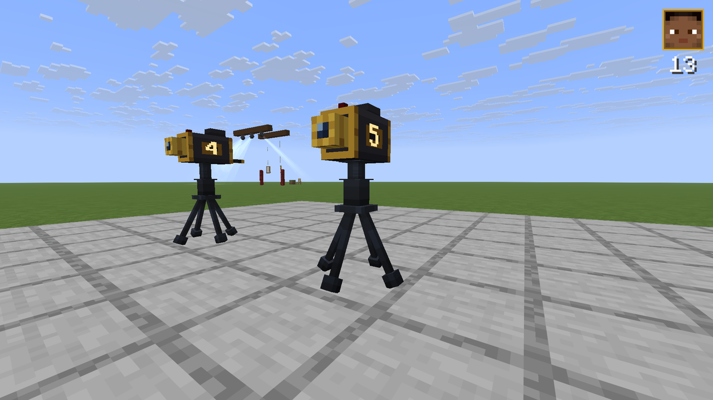
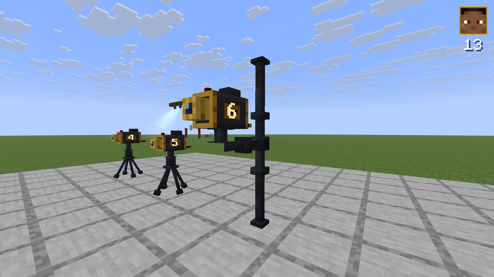
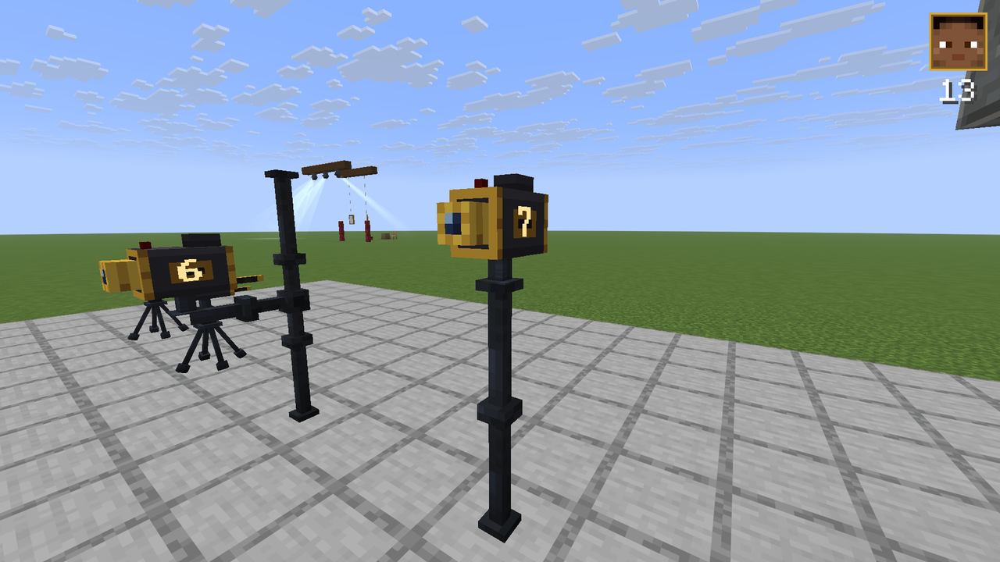
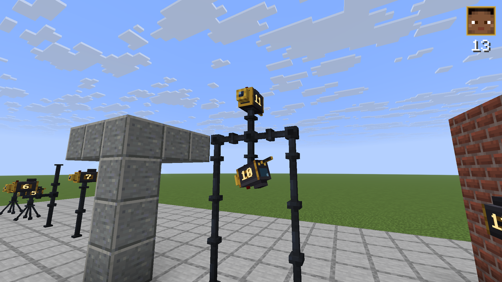
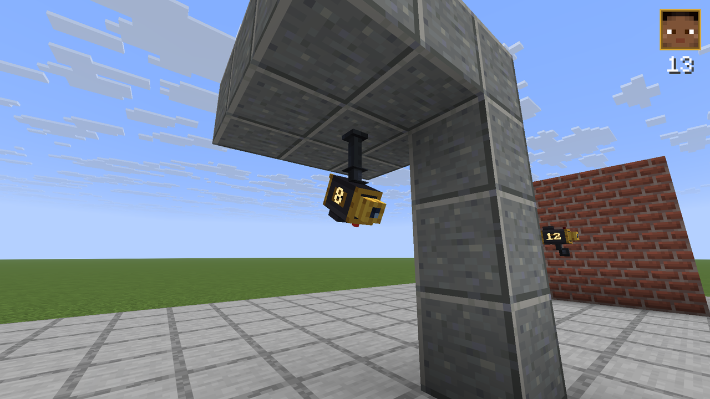
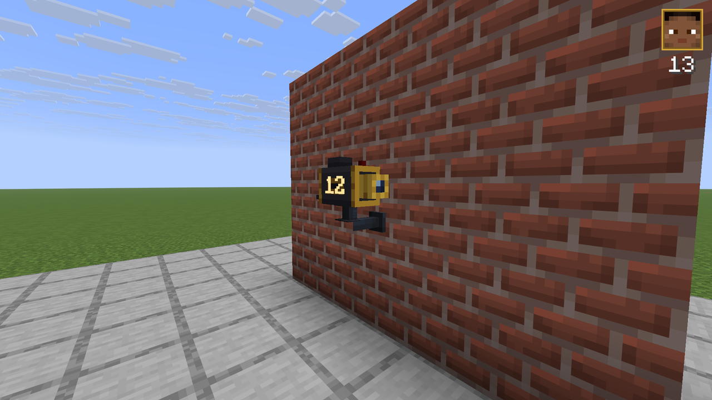

# Plateau : décor du studio

Tout le mobilier du plateau télé, dans l'onglet créatif **CraftMaster** (et en recette). Or, velours rouge et
papier crème comme l'affiche ; rien n'est copié d'une émission existante.

Le trône, la chaise de candidat, les lumières de studio, les softbox, le cadre, le trépied (aussi sous les
caméras), le carrelage et la paroi du globe sont **les modèles de LordFinn**, repris tels quels du pack ItemsAdder
de son serveur (voir [Mobilier du serveur](#mobilier-du-serveur)).

## Sièges
| Objet | Bloc | Utilisation |
|---|---|---|
| Trône du maître du jeu | `craftmaster:throne` | Le trône du serveur : bois doré et velours rouge, couronne au sommet (1,7 bloc de large, 4,5 de haut). Clic droit : on s'assoit, comme sur les [chaises](Chaises.md) ; s'accroupir pour se lever |
| Chaise de candidat | `craftmaster:candidate_chair` | La chaise de candidat du serveur (bois doré, assise et dossier rouges, ~1,8 bloc de haut) ; s'assoit pareil |

Tous sont posés face à soi (le dossier de l'autre côté), comme les chaises.

**Retirés** (retours de LordFinn, 12/11/2026) : le fauteuil de l'assistant, le canapé de velours, le trophée
CraftMaster (le trophée de l'émission est une tête de joueur, la grenouille d'or) et les marches du podium. Un monde
qui en contient se charge sans erreur : `craftmaster:trophy` devient une **tête de joueur** (bloc et objet), les
marches du podium du **quartz** (1er et 2e : bloc, 3e : dalle), `assistant_chair` et `sofa` disparaissent (alias
de registre, `Studio.removed()`). La révélation de fin (`/craftMasterReveal`) n'en dépendait pas : ses feux
d'artifice partent des bustes du classement (`/craftMasterAddBust`).

## Éclairage
| Objet | Bloc | Utilisation |
|---|---|---|
| Lampadaire | `floor_lamp` | Abat-jour crème en haut (2 blocs de haut), lumière 15. Clic droit : allumer / éteindre |
| Lampe de bureau | `desk_lamp` | Lampe de banquier : socle et tige en laiton, abat-jour en verre vert, la lumière dessous ; lumière 12, clic droit |
| Suspension | `ceiling_pendant` | Rosace au plafond, chaîne dorée (comme la chaîne du jeu) jusqu'à l'abat-jour à deux étages, ampoule ; se pose sous un plafond (tombe si le bloc au-dessus part), lumière 15, clic droit |
| Projecteur | `spotlight` | Sur le sol, ou suspendu sous un plafond. Voir ci-dessous |
| Lumière de studio | `studio_light` | Petit projecteur sur pied, lumière 15. Au sol, **suspendue** sous un plafond ou une barre, ou **sur le côté** d'un mur (sur un petit bras fixé au mur) ou d'une barre (sur le bras de la barre). Posée face à soi (8 orientations). **Clic droit** : change l'angle (5 inclinaisons, du bas vers le haut) ; **accroupi + clic droit** : la tourne de 45° |
| Softbox | `softbox` | Grande boîte à lumière, lumière 15 ; au sol, au plafond, contre un mur (debout, dos au mur) ou sur le côté d'une barre (debout sur son bras). Clic droit : 4 angles ; accroupi + clic droit : tourner |
| Enseigne « EN DIRECT » | `on_air_sign` | Caisson lumineux à cadre doré (côtés compris) contre un mur, plus large que le bloc. Clic droit ou courant de redstone (allumée tant qu'elle est alimentée) |

### Projecteurs
- Faisceau visible (cône de lumière qui s'estompe) jusqu'au premier bloc rencontré (48 blocs max), avec une
  tache de lumière où il arrive ; **vraie lumière** : un bloc `minecraft:light` invisible (niveau 15) est posé là
  où le faisceau touche, déplacé quand le projecteur bouge, retiré quand il s'éteint ou est cassé.
- Posé : il éclaire droit devant (dans le sens où l'on regarde), un peu vers le bas s'il est suspendu.
- Clic droit : allumer / éteindre. **Accroupi + clic droit (main vide)** : il pointe là où l'on regarde (se mettre
  à côté et viser la cible). **Teinture** à la main : couleur du faisceau (blanc = blanc chaud).
- Il tourne en douceur (lyre et tête motorisées) ; en mode **suivi**, il suit un joueur en permanence.
- Commandes et voix ci-dessous (« projecteurs sur Ensuri »).

## Décor
| Objet | Bloc | Utilisation |
|---|---|---|
| Cadre | `decor_frame` | Cadre doré vide (1,5 bloc) : contre un mur, au plafond ou à plat au sol, sans collision |
| Pied de trépied / barre de trépied | `tripod`, `tripod_rod` | Le trépied du serveur ; les barres s'assemblent en **structures** (voir [Structures de barres](#structures-de-barres)) |
| Carrelage noir et blanc | `checker_tile` | Bloc plein, damier |
| Paroi du globe CraftMaster | `globe_panel` | Verre blanc, une face avec la porte : pour construire le globe |

### Structures de barres
Les barres de trépied (`tripod_rod`, la barre du serveur, même texture et même épaisseur) se relient toutes seules,
comme des barrières, mais dans les **6 directions** : tours, poutres, angles, T, croix, et croisements en 3D.

- **Poser** : clic droit sur une barre pour la prolonger de ce côté (dessus : la tour monte ; sur le côté : une
  poutre part). Une barre se relie à toutes les barres autour d'elle, au **haut d'un trépied** posé dessous, et aux
  **lumières accrochées** à elle.
- **Accroupi en posant** : elle ne se relie qu'au bloc contre lequel on la pose (deux poutres côte à côte sans se
  toucher, par exemple).
- **Contre un mur, un plafond, le sol** : posée contre lui, elle s'y fixe par une petite platine ; le bout d'une
  poutre qui touche un mur s'y fixe aussi.
- Une barre seule (ou une ligne droite) traverse tout son bloc, avec la bague du modèle de LordFinn à chaque bout ;
  là où des barres se croisent en angle, un **collier** carré les tient.
- Fines : pas de collision de bloc plein, on passe à côté. **On grimpe** le long d'une barre comme à une échelle.
- Casser une barre détache ses voisines (elles redeviennent droites).

**Lumières sur la structure** : poser la lumière contre la barre, du côté voulu.
- **Dessous** : lumière de studio, softbox ou projecteur **suspendus** (la barre descend jusqu'à eux, leur pied est
  pris dans la bague).
- **Dessus** : posée sur la barre, comme sur le sol.
- **Sur le côté** : la barre sort un petit bras ; la lumière de studio ou la softbox se tient **debout sur ce bras**,
  tournée vers celui qui la pose. Clic droit (angle) et accroupi + clic droit (45°) marchent partout.
- Les projecteurs (qui suivent un joueur) s'accrochent dessus ou dessous, pas sur le côté.

**Caméras sur la structure** : l'objet Caméra de studio se pose de la même façon (voir
[Réalisation](Realisation.md#les-caméras)) : sur un pied de trépied ou sur une barre (sans pattes), **suspendue à
l'envers** sous une barre ou un plafond, sur le côté d'une barre ou d'un mur (debout sur un petit bras). Là où la
barre ne va pas jusqu'à elle (le dessus d'une poutre, le côté d'une tour), la caméra ajoute le bras de la barre et
son collier. Le plan de diffusion part toujours de son objectif.

| | | |
|---|---|---|
|  |  |  |
|  |  |  |

## L'émission
| Objet | Bloc / objet | Utilisation |
|---|---|---|
| Tablette chrono | `timer_tablet` | Cadre photo autour d'un écran à chiffres 7 segments (comme celui que tient l'assistant de Taskmaster), réglable de A à Z ([ci-dessous](#tablette-chrono)) |
| Chrono géant | `timer_display` | Panneau doré « 1 · Le Pont » + le temps en grands chiffres à 7 segments. Se fixe à un mur (le panneau monte au-dessus du bloc). Clic droit : plus grand (1 à 6 : 2,5 × 1 à 15 × 6 blocs), accroupi : plus petit |
| Écran du studio | `studio_screen` (objet) | Écran plat posé sur un mur, 3 × 2 blocs, qui montre une image téléchargée, ou une **vidéo** avec WaterMedia ; voir `/image` |
| Pupitre de candidat | `contestant_desk` | Pupitre en noyer et velours, plaque en laiton au nom du candidat, tournée vers le public (celui qui le pose). Nom : une **étiquette renommée** utilisée dessus (elle est gardée), ou `/craftMasterDesk name`. **Côte à côte** (même sens), les pupitres forment un seul long pupitre (plus de montants ni de bord doré entre eux). **Clic droit** (sauf étiquette) : son **tiroir**, 9 cases |
| Sonnette de comptoir | `desk_bell` | « Ding » quand un candidat a fini : les organisateurs voient « ♪ Ensuri a sonné (1:42 restantes) » ; impulsion de redstone, une fois par demi-seconde |
| Gong | `gong` | Disque doré dans un cadre en chêne noir du jeu (montants et poutre en bûche écorcée, pieds en planches). Clic droit (ou impulsion de redstone) : un coup de gong entendu dans tout le studio, le disque se balance. **Un organisateur accroupi** termine en plus la manche en cours (comme `/craftMasterManche end`, annulable) |
| Table des prix | `prize_table` | Table drapée de velours ; jusqu'à 4 prix posés à plat (un par quart du plateau) : clic droit **sur le dessus** avec l'objet pour le poser, main vide pour le reprendre. Clic droit **sur le drapé** (les côtés) : l'**étagère cachée** dessous, 27 cases. Côte à côte (même sens), les tables forment une seule longue table sous un seul drapé. Casser la table fait tomber les prix et l'étagère |
| Poteau à cordon | `stanchion` | Poteaux en laiton ; un cordon de velours pend jusqu'au poteau suivant sur la même ligne (est ou sud, jusqu'à 4 blocs, sans mur entre les deux) |

### Ce qu'affiche le chrono géant
- Avant de lancer une manche à chrono : sa durée, en crème (« 3:00 »).
- Pendant : le temps restant en or, en **rouge clignotant** les 10 dernières secondes.
- À la fin du temps : « 0:00 » rouge qui clignote 8 s.
- Sans manche ni chrono : « -:-- » discret. Le bandeau donne « numéro · nom » de la manche en cours (« CraftMaster » sinon).

Il suit le chrono de l'émission (barre de boss, `/craftMasterManche start`, la voix), il n'a rien à régler.

### Tablette chrono
Un cadre photo autour d'un passe-partout et d'un verre sombre à chiffres 7 segments, au pixel près (une case de
chiffre = 1 px en taille 1, 2 px en taille 2…). Cadres : **chêne** et **noyer** en vrai bois du jeu (montants en
bûche écorcée, traverses en planches, dos en planches), **laque noire**, **laque rouge**, **blanc peint** (dos laqué
avec fente d'accroche), **laiton** et **acier brossé** (dos en métal vissé). Passe-partout blanc, crème ou noir, en
dégradé avec biseau. Chevalet de peintre en chêne : pieds derrière la tablette, auget devant, pied arrière.
- **Poser** : contre un mur = accrochée ; au sol = debout sur son pied, tournée vers soi (16 directions, comme un
  panneau) ; accroupi = à plat (sur une table). Organisateurs : **accroupi + clic droit** = debout → chevalet → à plat.
- **Clic droit (organisateurs)** : l'écran de réglages, avec un aperçu en direct et ▶ Démarrer, ⏸ Pause, Remettre,
  Relancer. Tout changement se voit tout de suite sur la tablette.
- **Mode** : *Minuteur* (compte à rebours, durée « 1:30 », « 90 » ou « 1:00:00 »), *Chrono* (compte), *Heure*
  (l'heure du PC qui regarde), *Chrono de l'émission* (le même que le chrono géant et la barre de boss).
  **Format** : Auto (3:07, dixièmes sous 10 s : « 9.4 »), 3:07, 25.7 (dixièmes), 1:07.42 (centièmes), 187
  (secondes). **Alerte** : les N dernières secondes clignotent dans la couleur d'alerte.
- **Apparence** : couleur des chiffres (rouge, ambre, vert, bleu, blanc, or), segments éteints visibles ou non, cadre,
  passe-partout (blanc, crème, noir, aucun), taille × 1 à × 4, texte sous les chiffres (en mode Émission, vide = le
  nom de la manche).
- **Déclencheurs** : clic droit des joueurs (démarre / pause), redstone (rien, démarre / pause, tourne tant
  qu'alimentée, relance), démarre avec la manche, s'arrête en fin de manche, son de fin (bip, cloche, gong, buzzer),
  clignote à la fin, **comparateur** à 15 quand le minuteur est fini (portes, lampes…), **groupe** : les tablettes
  d'un même groupe démarrent et s'arrêtent ensemble.
- **Position** : debout, sur chevalet (inclinaison 0 à 60°), à plat.
- **La sonnette** (sonnette de comptoir posée à 2 blocs ou moins) : sonner **arrête** la tablette (et son groupe),
  comme dans Taskmaster ; le temps figé clignote, une note s'envole de la sonnette, et les organisateurs lisent
  « ♪ Ensuri a sonné — tablette arrêtée à 25.7 ». Son impulsion redstone ne relance jamais la tablette.
- **S'arrête avec le chrono** (coché par défaut) : arrêter le chrono de l'émission (StreamDeck `/timer/stop`, la voix,
  `/craftMasterTimer stop`) met aussi la tablette en pause.
- Commande : `/craftMasterTablet start|pause|toggle|reset|restart [groupe]` (`/cftb`, organisateurs) ; StreamDeck :
  `http://127.0.0.1:25710/tablet/start?group=plateau` ([Saisie](Saisie.md)).
- Tenue en main, c'est un petit cadre « 25.7 » fixe : les chiffres vivants ne s'affichent que posée (à venir).

### `/image` : images et vidéos sur les écrans
Remplace le `/image <URL>` du plugin (qui passait par ImageFrame). Avec WaterMedia (modpack, 26.2), un écran passe
aussi des vidéos, des clips Twitch, des directs et les clips enregistrés en jeu : écrans nommés et `/cmtele`, voir
[Clips et télés](Clips.md).

**Vidéos** : avec [WaterMedia](https://modrinth.com/mod/watermedia) 3.0.1+ (et ses binaires, WaterMedia Binaries)
dans le jeu des joueurs, une adresse qui n'est pas une image (.png, .jpg, .jpeg, .gif, .bmp, .webp) est **lue comme
une vidéo** : YouTube, Twitch, Kick, un lien MP4 / WebM direct… Le mod CraftMaster ne l'exige pas : sans WaterMedia
(ou en 26.3, que WaterMedia ne prend pas en charge), les écrans ne montrent que des images, et une vidéo affiche
« Pas une image : les vidéos demandent le mod WaterMedia ».
- Même image pour tout le monde : le serveur garde où en est la vidéo, chaque jeu se cale dessus (à 2 s près).
- Le son vient de l'écran : plein jusqu'à 4 blocs, s'éteint à 40 ; réglage « Juke-box / blocs musicaux » du jeu.
- `/image play`, `/image pause`, `/image restart`, `/image seek <secondes>`, `/image volume <0-100>`,
  `/image loop <true|false>` (en boucle par défaut), sur l'écran regardé.
- Un écran hors de vue depuis 5 s, ou à plus de 128 blocs, arrête son lecteur chez ce joueur (il reprend au bon
  endroit quand on le revoit).

- `/image <URL> [largeur] [hauteur]` en **regardant un écran du studio** : il affiche l'image (et change de taille
  si on la donne). En regardant **un mur** : un nouvel écran y est accroché, centré sur le bloc visé, 5 × 3 par
  défaut comme le plugin (largeur seule : hauteur en 5:3), au plus 64 × 36 blocs (écran géant de scène).
- `/image clear` (retour à la mire), `/image remove`, `/image size <l> <h>`, `/image fit <true|false>` (image
  entière avec bandes noires, ou étirée), sur l'écran regardé.
- Clic droit sur un écran (avec la permission) : réglages (adresse, taille, image entière / étirée, mire).
- Permission **`craftmaster:image`** (comme `craftmaster.image` du plugin) ou organisateur.
- Le jeu de **chaque joueur** télécharge l'image (le serveur ne transmet que l'adresse), en arrière-plan : PNG,
  JPEG, GIF (première image) ou BMP, 12 Mo au plus, réduite à 2048 px si plus grande. Gardée en mémoire et dans
  `craftmaster/image-cache/` du dossier du jeu (7 jours). Pendant le chargement : la mire CraftMaster avec
  « Chargement… » ; adresse injoignable ou format inconnu : la mire avec « Image indisponible : HTTP 404 »…
- L'écran s'éclaire lui-même (pleine luminosité), visible de loin (160 blocs). Il se casse comme un tableau.
- Les images d'épreuve (un plan, une consigne illustrée) se mettent de la même façon sur un écran.

## Commandes
| Commande | Alias | Effet |
|---|---|---|
| `/craftMasterImage <URL> [l] [h]` | `image`, `cfim` | Voir ci-dessus (permission image) |
| `/craftMasterSpotlight follow <joueur>` | `cfsp` | Le projecteur regardé suit le joueur (et s'allume) |
| `/cfsp stop` / `on` / `off` | | Arrête de suivre (garde sa direction) / allume / éteint |
| `/cfsp color <teinture>` | | Couleur du faisceau (`red`, `light_blue`…) |
| `/cfsp here` | | Pointe vers soi (se placer là où la lumière doit tomber) |
| `/cfsp all <follow\|stop\|on\|off\|color\|here> …` | | Tous les projecteurs chargés |
| `/cfsp list` | | Les projecteurs chargés, allumés ou non, suivi |
| `/craftMasterDesk name <nom>` | `cfdk` | Nom du pupitre regardé (`-` : plaque vide) |
| `/craftMasterGong` | `cfgo` | Coup de gong sur le gong le plus proche (32 blocs) |

Toutes admin sauf `/image` (permission image). Messages en français, Tab propose joueurs et couleurs.

## Régie vocale
- « Projecteurs sur Ensuri », « lumière sur Juste » → `spotlight.follow {player}` (pseudo ou surnom)
- « Projecteurs fixes » → `spotlight.stop` ; « éteins / allume les projecteurs » → `spotlight.off` / `spotlight.on`

Ces ordres ne touchent pas aux données (rien à annuler) ; ils marchent aussi en mode hors ligne.

## Recettes
| Objet | Recette (lignes) |
|---|---|
| Trône | `O·O` / `OVO` / `OBO` — O lingot d'or, V laine rouge, B bloc d'or |
| Lampadaire | laine blanche / torche / lingot d'or (colonne) |
| Lampe de bureau | verre vert / torche / pépite d'or |
| Suspension | pépite d'or / lingot d'or / torche |
| Projecteur | `·F·` / `FGF` / `FFF` — F lingot de fer, G pierre lumineuse |
| Enseigne « EN DIRECT » | vitre noire, lampe à redstone, vitre noire |
| Tablette chrono | `PCP` / `PGP` — P béton noir, C horloge, G vitre |
| Chrono géant | `OHO` / `RBR` — O lingot d'or, H horloge, R redstone, B béton noir |
| Écran du studio | `BBB` / `BVB` — B béton noir, V vitre |
| Pupitre | `DDD` / `VOV` / `P·P` — D dalle de chêne noir, V laine rouge, O lingot d'or, P planches de chêne noir |
| Sonnette | pépite d'or / lingot d'or / dalle de bois |
| Gong | `BBB` / `BOB` / `B·B` — B bâton, O bloc d'or |
| Table des prix | `VVV` / `POP` / `P·P` — V laine rouge, P planches, O pépite d'or |
| Poteau à cordon (×2) | pépite d'or / bâton / lingot d'or |

## Sons
`craftmaster:studio.gong` (cloche grave) et `craftmaster:studio.desk_bell` (note de cloche aiguë) : des sons
vanilla réaccordés, remplaçables par un pack de ressources (`assets/craftmaster/sounds.json`).

## Notes techniques
- Paquet `craftmaster:studio_timer` (serveur → clients) : chrono en cours, secondes restantes, durée de la manche,
  nom et numéro ; envoyé à chaque changement (une fois par seconde pendant le chrono) et à la connexion. Il lit
  `Show.timerRemaining` sans rien modifier.
- Écrans : entité `craftmaster:studio_screen` (adresse, largeur, hauteur, sens, image entière ; vidéo : tick de
  départ, position de pause, boucle, volume, sauvés comme position) ; paquets `studio_screen_open` /
  `studio_screen_save` pour l'écran de réglages. Vidéos : `client/studio/ScreenVideos` (ne touche jamais une classe
  de WaterMedia), `WaterMediaScreens` (un lecteur par écran, moteur OpenGL de WaterMedia, son OpenAL) et
  `VideoTexture` (la texture OpenGL de WaterMedia montrée comme une texture du jeu, sans copie ; 26.2 seulement).
  WaterMedia est une dépendance de compilation (`compileOnly`, Modrinth), jamais livrée ; `fabric.mod.json` la
  « suggère ».
- Pupitres et tables qui se joignent : `JoiningBlock` / `SideJoins` (propriétés `left` / `right`, à gauche / droite
  du sens du bloc, comme l'ancien canapé) ; rangements : `StudioStorage` (sauvé sous `Storage`, jamais envoyé aux
  clients).
- **Mobilier du serveur** : les modèles et textures de LordFinn, copiés de son pack
  ItemsAdder « sandbox » dans `scripts/ia_sandbox/`, convertis par `scripts/gen_furniture.py` (seuls les noms de
  textures changent). Sur le serveur, ce sont des modèles d'objet montrés par un cadre invisible (une entité
  d'affichage pour les softbox), bien plus grands qu'un bloc : ici, le bloc garde le comportement (siège, lumière,
  collision) et une entité de bloc commune (`craftmaster:furniture`, `Furniture` / `client/studio/FurnitureRenderer`)
  dessine le même modèle avec les transformations du cadre ou de l'entité d'affichage de Minecraft. Le trépied et
  sa barre sont des modèles de bloc ordinaires ; la caméra (`CameraRenderer`) les dessine sous son boîtier, seul le
  visuel a changé. Le pack tiers « livingroom » du serveur n'est pas repris.
- **Structures de barres** : `RigRodBlock` (6 propriétés `north`… `down`, les liaisons, toujours réciproques entre
  deux barres) et `RigLinks` (logique pure, testée par `RigLinksTest`). Le modèle est un multipart généré par
  `gen_furniture.py` à partir des pièces de la barre de LordFinn : un bras par côté relié (`rig_arm`, la moitié de son
  tube et sa bague) et un collier (`rig_knuckle`). Une lumière posée sur le côté d'une barre (ou une lumière de studio
  contre un mur, avec son bras `rig_arm`) est dessinée debout sur ce bras par `FurnitureRenderer`. Les caméras (des
  entités, pas des blocs : la barre ne se relie pas à elles) dessinent elles-mêmes ce bras et le collier
  (`rig_knuckle`) quand la barre n'en a pas de ce côté (`CameraMount`, `CameraRenderer`).
- Projecteurs, chrono, pupitres, table, gong, poteaux : entités de bloc dessinées par le client
  (`client/studio/`). Le projecteur vise côté client à chaque image (suivi fluide), le serveur ne déplace que le
  bloc de lumière (toutes les 4 ticks).
