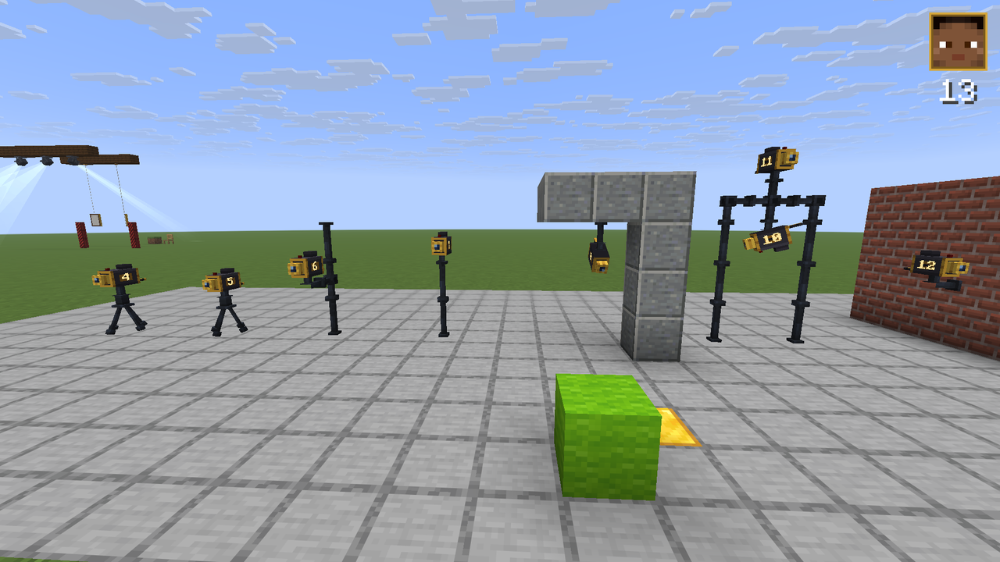
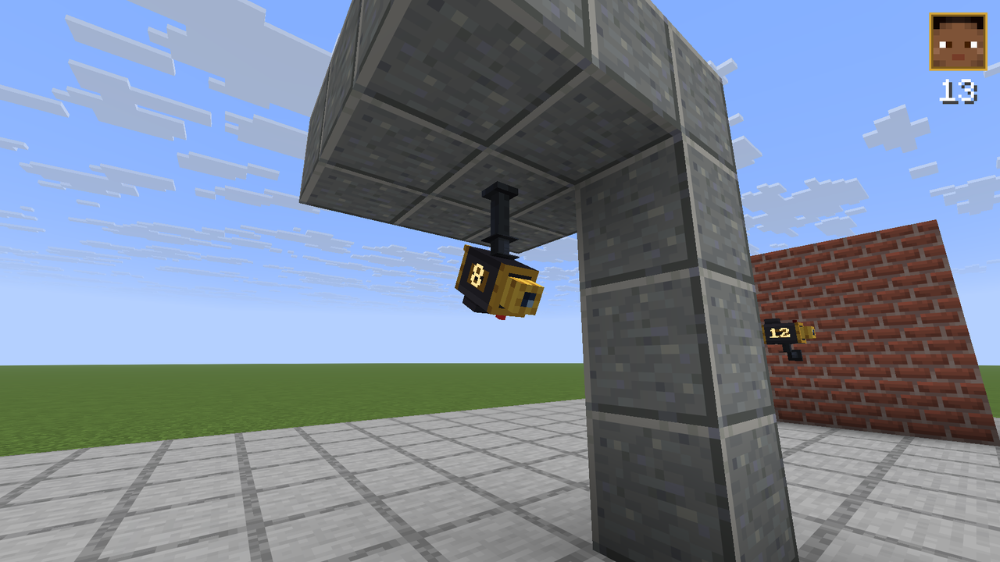
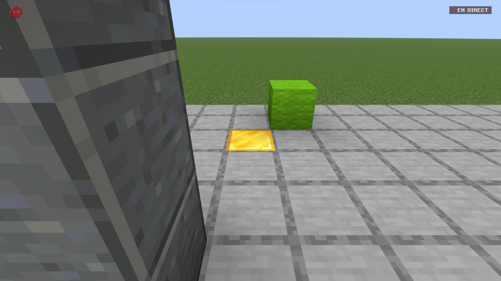

# Réalisation TV : caméras, mode diffusion, habillage, générique

Ce que le public Twitch voit : un jeu « caméra » (le **client de diffusion**, capturé par OBS) qui n'affiche plus
l'interface de Minecraft mais **les plans des caméras du studio** et **l'habillage de l'émission** (logo, bandeau de
la manche avec le chrono, synthés avec le nom des candidats, scores publiés, points en direct, générique).
Tout est piloté depuis le serveur : LordFinn (ou un réalisateur) change de plan par commande, à la voix ou avec les
touches 1 à 9 du client de diffusion ; plusieurs jeux en mode diffusion montrent exactement la même chose.

## En bref, le soir du direct
1. Une fois : poser les caméras du studio (voir plus bas), leur donner un rôle (`/cam role 1 large`,
   `/cam role 2 trone`, `/cam role 4 podium`).
2. Sur le PC de diffusion : se connecter avec le compte caméra, de préférence **en spectateur**
   (`/gamemode spectator <compte>`), puis **F8** (ou `/diffusion`, ou depuis n'importe quel jeu admin
   `/tv broadcast <compte> on`). OBS capture la fenêtre du jeu (1920 × 1080 conseillé).
3. `/tv intro` (ou « générique ») au début, `/cam auto on` (ou « réalisation automatique ») si on veut que la
   réalisation se fasse toute seule, `/tv outro` (« générique de fin ») à la fin.

## Les caméras
- **Objet « Caméra de studio »** (onglet CraftMaster, recette : lingot de fer, verre, lingots, bâtons) : clic droit
  sur le sol → un trépied avec sa caméra, numéro suivant, objectif tourné comme le regard du joueur. Elle se fixe
  aussi **comme les lumières de studio** (voir [Plateau, structures de barres](Plateau.md#structures-de-barres)), selon
  la face visée :

  | Clic droit sur… | La caméra |
  |---|---|
  | le sol (le dessus de n'importe quel bloc) | debout sur son propre trépied (comme avant) |
  | le dessus d'un **pied de trépied** (`tripod`) | posée dessus, sans pattes, sur une courte tige |
  | le dessus d'une **barre** | posée sur la barre (si la barre ne monte pas jusque-là, son bras et un collier sont ajoutés) |
  | le dessous d'un **plafond** | **suspendue à l'envers** sous une tige d'un demi-bloc (platine au plafond) |
  | le dessous d'une **barre** | suspendue à l'envers sous la barre |
  | le côté d'un **mur** | debout sur un petit **bras** fixé au mur (le même que la lumière de studio) |
  | le côté d'une **barre** | debout sur un bras qui part de la barre, avec son collier |

  Le plan est toujours pris **depuis l'objectif** : sa hauteur dépend de la fixation (1,5 bloc au-dessus du sol sur
  le trépied, juste au-dessus du support sinon, juste en dessous quand elle est suspendue). Viser (`/cam aim`, le
  bouton [Viser comme moi]) et tous les réglages marchent pareil partout ; une caméra suspendue est dessinée à
  l'envers, son numéro reste lisible. `/cam here` la remet sur un trépied au sol, à la place de tes yeux. Les caméras
  posées avant gardent leur trépied.

  
   
- **`/cam here <n> [nom]`** (le plus pratique pour cadrer) : la caméra n se met **à la place de tes yeux, regardant
  là où tu regardes**. On se place, on regarde le plan voulu, on tape la commande. Une caméra existante est déplacée.
- `/cam placer <n> <x y z> vers <x y z>` : sans bouger (console, [Régie IA](RegieIA.md)) : l'objectif à ces coordonnées,
  regardant la cible ; une caméra nouvelle est un simple point de vue (pas de trépied).
- `/cam aim <n>` : la caméra garde sa place, elle regarde là où tu regardes. `/cam goto <n>` : tu vois exactement ce
  que voit la caméra (pour vérifier, puis `/cam here <n>` pour recadrer d'ici).
- Clic droit sur une caméra (réalisation) : son numéro, son réglage, sa fixation et des liens cliquables (à
  l'antenne, viser, renommer, rôle). Un coup dessus la retire.
- Réglages : `/cam name <n> <nom>`, `/cam role <n> large|trone|podium|aucun` (un seul rôle par caméra et par rôle),
  `/cam zoom <n> <15..110>` ou `reset` (champ de vision), `/cam motion <n> fixe|respiration|travelling|panoramique`.
- **Mouvement** : *respiration* (défaut) = la caméra « respire » de quelques centimètres et d'une fraction de degré,
  comme une caméra sur pied tenue par un cadreur ; *travelling* = avance lentement (1,6 bloc max, ralentit) ;
  *panoramique* = balaie doucement ±7° ; *fixe* = immobile.
- Sur la diffusion, les trépieds **ne sont jamais affichés** (on voit à travers), ni le joueur caméra, ni les
  spectateurs, ni les pseudos au-dessus des têtes (le synthé nomme les candidats). En jeu, le **voyant rouge** d'une caméra s'allume quand elle est à l'antenne, et son numéro est peint
  sur ses flancs.
- Les caméras sont enregistrées dans `config/craftmaster/cameras.json` (le plan marche même si le trépied est dans
  une zone non chargée), avec leur fixation (`mount` : `tripod`, `rod_top`, `ceiling`, `rod_under`, `wall:<côté>`,
  `rod_side:<côté>` ; absent = trépied au sol).
- Côté code : `camera/CameraMount` (logique pure, testée par `CameraMountTest`) choisit la fixation et place
  l'entité (`CameraEntity`, à l'« ancre » : les pieds, le haut du support, le bout du bras) et l'objectif ; le serveur
  décide, `client/broadcast/CameraRenderer` ne fait que dessiner (pièces `rig_arm` / `rig_knuckle` des barres).

## Changer de plan
| Moyen | Exemples |
|---|---|
| Commandes | `/cam cut 2` · `/cam cut "Plan large" fondu` · `/cam cut trone enchaine` · `/cam wide` · `/cam next` / `prev` · `/cam follow Ensuri` |
| Voix | « caméra 2 », « plan large », « plan sur le trône », « le podium », « suis Ensuri », « caméra 3 en fondu » |
| Client de diffusion | touches **1 à 9** = caméra 1 à 9 du lieu actif, **molette** = caméra précédente / suivante (sur un plan qui suit : rapproche / éloigne), **Tab** / Maj + molette = zone suivante, **0** = écran partagé, `/diffusion camera <n, nom ou clé>`, `/diffusion zone <zone\|next>` |

- Les touches et la molette du client de diffusion demandent la coupe au serveur : elle n'est faite que si ce
  joueur est organisateur ou a la permission **`craftmaster:camera`**. Suivre la réalisation ne demande rien.
- **Transitions** : *coupe* (sèche, par défaut), *fondu* (passage par le noir), *enchaîné* (l'image précédente se
  fond dans la nouvelle), et pour les intros d'épreuve :
  - *miroir* (« kaléidoscope ») : l'image se replie en six segments en miroir qui tournent, la coupe se fait au plus
    fort, puis la nouvelle image se déplie (1 s) ;
  - *flash* (« flash blanc ») : coupe sous un flash blanc qui s'éteint en une demi-seconde ;
  - *surimpression* (« double exposition ») : la nouvelle image monte par-dessus l'ancienne, figée, les deux restent
    superposées un moment, puis l'ancienne s'efface (1,6 s ; par exemple un plan du trône par-dessus le ciel).

  Par plan (`/cam cut 2 enchaine`, `/cam cut trone surimpression`) ou par défaut (`/cam transition fondu`). Partout
  où une transition se donne : coupes, trajets, plans d'intro (`/tv intro <m> plan 1 transition miroir`), voix
  (« caméra 2 en miroir », « flash blanc sur le trône »). Un jeu de diffusion d'une version plus ancienne du mod
  joue ces trois-là en coupe.
- **Plan qui suit un joueur** (`/cam follow`) : son nom s'affiche en synthé quelques secondes, puis la caméra
  change de cadrage toute seule (voir *Le plan qui suit un joueur* plus bas) ; on peut la prendre en main.
- **Réalisation automatique** (`/cam auto on|off`, « réalisation automatique ») : coupe sur le candidat qui marque
  (7 s), sur celui qui ouvre son enveloppe ou qu'on met en lumière (`/tv spotlight <joueur>`, 9 s, avec un synthé
  « ouvre son enveloppe »), sur la caméra *podium* pendant toute la révélation, sur le plan large au lancement d'une
  manche et à la fin de chaque plan automatique. Une coupe à la main reprend la main.
- **Sur qui parle** (avec Simple Voice Chat sur le serveur) : la réalisation automatique coupe aussi sur celui qui
  parle, avec le même choix que « on va voir » : une caméra posée qui le voit bien (plus il prend de place dans
  l'image, plus elle a de chances, jamais collé à l'objectif ni caché par un bloc), sinon le plan qui le suit ; son
  nom ne s'affiche que la première fois (ou après 3 min sans l'avoir montré), pas à chaque aller-retour. Sans clignoter : une voix
  ne compte qu'après ½ s (une toux, un « oui » ne coupent pas), un plan tient au moins 2 s (3 s pour un plan de
  groupe), toujours en coupe sèche, un échange à deux ou
  plusieurs passe sur une caméra qui les voit tous au lieu du ping-pong, et après 5 s de silence on passe sur la
  caméra qui voit le plus de joueurs (sinon le plan large). **En manche**, si les candidats sont dans des zones
  différentes et qu'aucune caméra n'en voit deux, le silence passe en **écran partagé** : une tuile par zone
  occupée (sa caméra qui voit le mieux, sinon une tuile qui suit son joueur), disposition tirée au sort parmi celles
  qui vont (deux : bord à bord ou cadres ; plus : cadres ou un en grand) ; seulement si toutes les tuiles sont dans
  la même dimension et assez proches pour que le jeu de diffusion les voie toutes (distance de vue du serveur). Une coupe à la main lui laisse l'antenne 20 s ; un point, une mise en
  lumière, la révélation passent avant. **Suivre un joueur à la main** (le bouton du candidat dans la régie du site,
  `/cam follow Ensuri`, « suis Ensuri ») reste sur lui comme « reste sur Ensuri » : ni la voix, ni les points, ni les
  silences, ni le début d'une manche ne coupent ailleurs, jusqu'à ce qu'on choisisse un autre plan ou qu'on repasse en
  auto (la révélation, elle, reprend l'antenne). Seuls ceux qu'une caméra cadre comptent (pas les modos ni les spectateurs).
  `/cam auto voix on|off` (oui par défaut), `/cam auto voix` : où on en est. Rien n'est enregistré : seulement qui
  émet, et quand.
- Le joueur caméra en **spectateur** est déplacé tout seul près du plan (4 blocs sous l'objectif) pour que le
  serveur lui envoie le décor et les joueurs ; un joueur qui n'est pas spectateur n'est jamais déplacé.

## Le plan qui suit un joueur
La caméra tourne autour du joueur suivi comme un cadreur à l'épaule : elle tient un cadrage 7 à 12 s avec un
mouvement lent (elle tourne autour de lui, s'approche ou recule un peu), puis glisse en douceur vers le suivant.
Jamais deux fois le même d'affilée.

| Cadrage | En bref |
|---|---|
| trois-quarts (droite, gauche) | le visage de trois quarts, un peu au-dessus |
| profil | de côté, à hauteur d'yeux |
| face | droit devant, il vient vers nous |
| gros plan | le visage, tout près |
| contre-plongée | de bas, il paraît grand |
| plongée | de haut, on voit autour de lui |
| plan large | de loin, avec le décor |
| par-dessus l'épaule, de dos, trois-quarts dos | ce qu'il regarde, ce qu'il fait |

- Le joueur est placé sur un tiers de l'image, pas au centre.
- Quand il marche, la caméra préfère les cadrages qui le voient venir (face, trois-quarts).
- **Jamais dans un bloc ni derrière un mur** : un cadrage n'est choisi que s'il a la place ; si un mur passe entre
  le joueur et la caméra, elle se met devant aussitôt et ne recule qu'en douceur, en se décalant autour de lui (de
  côté, plus bas) vers là où il y a de la place, comme un cadreur qui fait un pas de côté. Si ça ne suffit pas (un
  couloir, un plafond bas), elle passe sur un cadrage qui a plus de place (dans l'axe du couloir, plus bas). Si le chemin d'un cadrage à
  l'autre traverse un mur, elle passe par un fondu enchaîné au lieu de glisser.
- **À la main** (sur le jeu de diffusion) : la **souris** tourne la caméra autour du joueur, la **molette** la
  rapproche ou l'éloigne (Maj + molette change toujours de zone, les touches 1 à 9 coupent toujours). Tant qu'on y
  touche, elle reste où on l'a mise ; **8 s** sans y toucher, les cadrages automatiques reprennent en douceur.
- **Caméras posées** : de temps en temps, si une caméra posée le voit bien, le suivi coupe sur elle quelques
  secondes (puis revient aux cadrages dès qu'il sort de son image). Plus il prend de place dans son image, plus elle
  a de chances d'être prise ; mais s'il est collé à l'objectif, elle est écartée. Il doit être vraiment visible
  (tête, poitrine ou pieds : au moins deux vus depuis l'objectif, pas cachés par un bloc) et bien dans le cadre, pas
  au bord.
- **Même suivi que les projecteurs** : la caméra suit le joueur sans traîner derrière lui quand il marche (elle
  vise un peu devant, là où il va), lui laisse de la place devant quand il traverse l'image, et accepte les mêmes
  règles que les poursuites : `/cam follow @moment` (le joueur du moment), `@candidat`, `@scene`, `@maitre`,
  `@rang:1` (« suis le premier du classement »), `@dernier`, `@hasard`, `@public`, `@proche`, `@zone:<nom>` ;
  le joueur est revu quatre fois par seconde tant que le plan est à l'antenne (il reste sur lui tant qu'il
  correspond) et, s'il change, la caméra coupe sur le nouveau au lieu d'un fondu.
  Dans l'autre sens, une poursuite `@antenne` éclaire le joueur que montre la réalisation.
- Les mêmes cadrages servent aux replays, aux plans « suivi » des intros de manche et aux **tuiles qui suivent un
  joueur** dans un écran partagé (`follow:<joueur>` à la place d'une caméra : chaque tuile a ses propres cadrages,
  sans prise en main, sans coupe sur une caméra posée).

### Consignes à la réalisation automatique
À la voix, aussi vite qu'un clic, ou en commande :

| Dit | Commande | Effet |
|---|---|---|
| « on va voir Ensuri », « et maintenant allons voir comment ça se passe chez Ensuri » | `/cam voir Ensuri` | une caméra posée qui le voit bien (tirée au sort, selon sa place dans l'image), sinon le plan qui le suit ; en manche, une fois sur trois environ, lui en grand et les autres zones en petit dessous ; l'auto continue ensuite |
| « reste sur Ensuri » · « tu peux lâcher Ensuri » | `/cam rester Ensuri` · `off` | rien ne coupe ailleurs (qui parle, points, mise en lumière, début de manche) jusqu'au prochain plan choisi à la main ; suivre un joueur à la main fait pareil |
| « plus large » · « plus serré » · « cadrage normal » | `/cam cadrage large\|serre\|auto` | cadrages plus loin / plus près, caméras qui le montrent plus petit / plus grand |
| « évite la caméra 3 » · « tu peux reprendre la caméra 3 » | `/cam eviter 3` · `off` | l'auto ne la prend plus (si elle est à l'antenne, on passe ailleurs) |
| « repasse en auto » | `/cam auto on` | plus de joueur retenu, cadrage normal (les caméras évitées le restent) |

Ces consignes ne sont pas enregistrées : elles tiennent jusqu'au redémarrage du serveur.

## Les lieux : caméras du studio et caméras des épreuves
Chaque caméra a un **lieu** : le **studio** (par défaut ; toutes les anciennes caméras y sont) ou une **manche**
(une épreuve, par son id : `pont`). Dans une manche, une caméra peut aussi appartenir à une **zone** : la salle d'un
candidat ou d'une équipe. Les zones sont les **zones d'épreuve** (`/craftMasterZone create salle-ensuri …` puis
`players salle-ensuri Ensuri`) : on donne à la caméra le nom de la zone, ou simplement le nom du candidat.

**Numéros : chaque lieu, et chaque zone, a ses caméras 1, 2, 3…** La salle d'Ensuri a sa caméra 1, celle de Cyllu
aussi. C'est le plus simple en direct : on choisit la salle, puis on appuie sur 1, 2 ou 3, et le numéro peint sur
le trépied est celui de la touche. (Le lieu et la zone sont écrits en petit sous le numéro, sur le trépied.)
Chaque caméra a aussi une **clé** unique pour la viser de n'importe où : `studio:2`, `pont:1`, `pont:ensuri:1`.

**Quelles caméras visent les touches 1–9, la molette et « caméra 2 » ?** Ça suit l'émission tout seul :
- manche lancée (et jusqu'à la révélation) : les caméras **de cette manche** si elle en a ;
- générique, intro du studio, révélation, entre deux manches : celles **du studio** ;
- dans une manche à zones : **Tab** (ou Maj + molette) passe à la zone suivante (Maj + Tab : précédente), puis
  1–9 = les caméras de cette salle ; « zone d'Ensuri » / « caméras de l'équipe bleue » à la voix (et ça montre son
  plan large), `/cam zone ensuri` ; « suis Ensuri » choisit aussi sa zone ;
- à la main, jusqu'au prochain temps de l'émission : `/cam focus studio`, `/cam focus pont [zone]`,
  `/cam focus auto` pour revenir au suivi automatique. `/cam focus` dit où on en est.
- Viser ailleurs reste possible à tout moment : `/cam cut studio:2`, « caméra 2 du studio », « caméra 1 d'Ensuri »,
  `/diffusion camera pont:2`. « Plan sur le trône » et « le podium » trouvent la caméra du studio même en manche.

| Mettre en place | Commande |
|---|---|
| Ranger une caméra | `/cam lieu <caméra> <studio\|manche> [zone]` : `/cam lieu 3 pont ensuri` · « la caméra 3 est sur le pont » |
| Poser directement | `/cam focus pont ensuri` puis `/cam here 1` (ou l'objet Caméra de studio) ; ou `/cam here pont:ensuri:1` |
| Voir | `/cam list` (le lieu actif), `/cam list tout` (tous les lieux), clic droit sur un trépied (son lieu + bouton [Lieu]) |

- Changer de lieu garde le numéro s'il est libre là-bas (sinon le premier libre) ; le trépied reste où il est.
- **Réalisation automatique en manche** : quand un candidat marque, ouvre son enveloppe ou buzze, elle coupe sur
  **la caméra de sa zone la plus proche de lui** (sinon le plan qui le suit), puis revient au plan large de la manche.
- **Écran partagé** : `/cam mosaic` (« écran partagé », touche **0** du client de diffusion) : jusqu'à 6 salles côte à
  côte, chacune par le plan large de sa zone, avec le nom des candidats. `/cam mosaic off` ou 0 pour revenir. Les
  vignettes se rafraîchissent à tour de rôle (une image sur deux, trois ou quatre) : parfait pour des salles où l'on
  construit, moins pour une course rapide. Connu : sur un terrain plat ouvert, une fine ligne orangée peut
  apparaître à l'horizon des vignettes (rien dans des salles fermées).
- **Plans choisis en écran partagé** (2 à 6) : Ctrl+clic sur les plans de la régie des modos (en jeu ou sur le site),
  ou à la voix (« mets la 3 et la 5 côte à côte ») ; dispositions cadres, bord à bord ou un principal en grand
  ([Régie des modos](RegieModos.md#plusieurs-plans-à-lantenne-écran-partagé)).
- `/cam pov Ensuri` (« vue d'Ensuri ») : à travers les yeux d'un joueur.

## Le menu d'une caméra (clic droit dessus)
Nom, rôle, zoom (glisser ou molette, clic droit : celui du spectateur), mouvement, **visible / cachée** (cachée :
personne ne la voit, sauf les organisateurs qui tiennent une caméra ou le clap), direction (clic : la taper), **Prendre le contrôle** (on voit ce qu'elle voit, la souris cadre ; clic ou Maj : garder,
Échap : annuler ; même chose pour un projecteur depuis son menu), **À l'antenne**, et ses **travellings**.

### Les travellings d'une caméra
Une caméra a autant de travellings qu'on veut (« + Nouveau travelling » dans son menu). L'éditeur, sur le côté de
l'écran, garde la scène en vue :
- **Étapes** : chacune est un cadre. Elles s'ajoutent, se déplacent, se tournent et se retirent **dans le monde**
  (voir plus bas) ; l'éditeur ne garde que ce que le monde ne montre pas. Un travelling peut partir de n'importe où ;
  une seule étape = un **plan fixe**.
- **Réglages d'une étape** : durée pour y arriver, pause, **transition** (douce, vitesse constante, démarrage doux,
  arrivée douce, **coupe**), FOV, **visée** (son propre angle, une **entité suivie** (un nom ou un sélecteur comme
  dans les commandes, `@n[type=sheep]`, `@p`, avec l'autocomplétion), le centre de la scène ou un point du plateau), angle tapé, **Prendre le contrôle** depuis l'étape.
- **Dans le monde** : avec le fantôme activé (ou le clap en main), chaque étape est un **point** ; en le visant il
  devient une caméra fantôme (sa place et sa direction), un **clic droit** ouvre l'éditeur sur cette étape. Une
  caméra fantôme parcourt le travelling en boucle. « Fantôme : oui / non » dans l'éditeur.
- **Couleurs** : chaque travelling d'une caméra a sa couleur, toujours dans le même ordre (orange, turquoise, violet,
  rose, bleu, vert, jaune, rouge) : son fantôme, ses points et son trajet en pointillés. Dans le menu de la caméra, la
  pastille de chaque ligne rappelle sa couleur ; **clic sur la ligne** = c'est lui qu'on édite dans le monde (par
  défaut le premier), **✎** = l'ouvrir dans l'éditeur. Les autres travellings restent visibles, plus pâles.
- **Édition au gizmo d'Axiom** (Axiom installé et activé) : le même outil que pour une entité d'affichage.
  - **clic gauche sur une étape** : elle prend le gizmo d'Axiom ; les **flèches et plans** la déplacent, l'**anneau
    horizontal** la tourne à gauche / à droite, l'**anneau de côté** vers le haut / le bas ;
  - **un point de plus** au-delà de chaque bout du trajet (un plan fixe : un de chaque côté) : **clic** dessus = une
    étape là, au début ou à la fin. Une caméra **sans travelling** a aussi un point de chaque côté : un clic crée son
    premier travelling (la caméra et ce point) ;
  - **clic sur le trajet en pointillés** : une étape à cet endroit (place et visée du trajet, la durée du tronçon
    partagée, le reste du minutage ne bouge pas) ;
  - **clic droit sur une étape** : l'éditeur sur cette étape ; **Suppr** : la retirer (l'étape suivante reprend sa
    durée) ; **Échap** : désélectionner. Fermer l'éditeur laisse son étape sélectionnée dans le monde.
- **Aperçu** (sur ton écran seulement), et dans la **timeline** une piste *Caméra* (plan : une caméra
  ou un travelling, et la transition de la diffusion).

## Les travellings enregistrés (trajets)
Un **trajet** est un mouvement de caméra en plusieurs **étapes** : la caméra glisse de l'une à l'autre en courbe
douce (pas de cassure aux étapes), démarre et s'arrête en douceur, et peut marquer une **pause** sur une étape.
1. Place-toi au départ, regarde le premier cadre : `/cam trajet pont point`.
2. Déplace-toi, regarde le cadre suivant : `/cam trajet pont point 3` (3 secondes pour y aller). Recommence.
   Plus simple : `/cam trajet pont objet` donne un **Repère de travelling** (clap) : **clic droit = une étape à tes
   yeux**, accroupi + clic droit = retirer la dernière.
3. Régler : `duree <s> [étape]` (temps pour arriver à l'étape), `pause <s> [étape]` (arrêt sur l'étape),
   `courbe lisse|lineaire|entree|sortie [étape]`, `zoom <15..110>|reset [étape]`, `remplacer <étape>` (refaire
   l'étape d'ici), `aller <étape>` (y aller pour vérifier), `suppr [étape]`, `lieu <lieu>`, `effacer`.
4. Vérifier : `/cam trajet pont` (la liste des étapes) ; `montrer` (la ligne dorée dans le monde 20 s, étapes en
   rouge, vue seulement par les organisateurs, jamais par la diffusion) ; `apercu` (le trajet joué **sur ton écran
   seulement**, avec le temps en haut).
5. À l'antenne : `/cam jouer pont [transition] [effet]` · « lance le travelling du pont ». À la fin, la caméra reste
   sur la dernière étape jusqu'au plan suivant. `/cam trajets` les liste.
- Les trajets sont dans `config/craftmaster/trajets.json`. Ils sont joués image par image par le jeu de diffusion
  (fluide à 60 i/s, même avec un serveur qui rame).

## L'intro animée d'une manche
Chaque manche peut avoir son **intro** : une suite de plans (caméras, trajets, joueurs suivis), chacun avec sa durée,
sa transition (enchaîné par défaut, fondu pour le premier ; aussi miroir, flash ou surimpression), un **effet
d'image** facultatif (`sepia`, `noir_blanc`, `pixel`, `fisheye`, `vignette`, `masque_rond`, `citrouille`, et pour
les intros d'épreuve `look_intro`, `macro`, `mise_au_point`, `stop_motion`, `timelapse` : voir [Effets](Effets.md))
et une **carte** facultative : *titre* (grand titre au
centre) ou *synthé* (bandeau en bas), avec le nom de la manche ou un texte (`Titre | sous-titre`). Sans carte, le
dernier plan montre le titre de la manche. Musique facultative (le thème, ou n'importe quel son). Pendant l'intro, le
logo et le bandeau de la manche se retirent, la réalisation automatique attend, puis le plan large de la manche
prend le relais.

| Faire | Commande (`<m>` = la manche) |
|---|---|
| Faire l'intro toute seule | `/tv intro <m> construire` (à partir des caméras de la manche, sur la musique d'intro ; remplace les plans) |
| Ajouter un plan | `/tv intro <m> ajouter camera large 4` · `ajouter trajet survol` · `ajouter suivi Ensuri 5` (+ `[transition] [effet]`) · `ajouter tache [s]` (lieu de la tâche) |
| Régler un plan | `/tv intro <m> plan 2 duree 3` · `plan 2 transition coupe` · `plan 2 effet sepia` · `plan 1 carte synthe Le Pont \| Épreuve 1` · `plan 3 retirer` |
| Réglages | `/tv intro <m> musique intro\|theme\|aucune\|<son>` · `titre on\|off` · `auto on` (jouée toute seule au lancement de la manche) · `effacer` |
| Look, consigne | `/tv intro <m> look look_intro\|aucun` (effet ajouté à tous les plans) · `consigne on\|off` (la tâche tapée en bas à la fin) |
| Lieu de la tâche | `/tv intro <m> lieu` (replace la caméra du plan « lieu de la tâche ») |
| Couper sur la musique | `/tv intro <m> rythme intro` (musique d'intro, 120 BPM) · `rythme theme` (tempo du thème, 112 BPM) · `rythme 96` · `rythme 120 4` (4 temps par plan) · `rythme 120 4 0,4` (1er temps à 0,4 s) · `rythme off` |
| Lancement enchaîné | `/tv intro <m> enchaine on\|off` (on par défaut, avec `auto on`) |
| Voir / jouer | `/tv intro <m> voir` · `/tv intro <m>` · « lance l'intro du pont » · `/tv stop` l'arrête |
| Éditeur | `/tv intro <m> voir` (cliquable) · `plan 3 essayer` (jouer à partir du plan 3, sans musique) · `plan 3 monter\|descendre` · `plan 3 camera <caméra>` · `plan 3 tache` |

- Les caméras d'un plan se lisent **dans le lieu de la manche** : `large`, `2`, `ensuri:1`, ou `studio:3`.
- **Coupé sur la musique** (`rythme`) : chaque plan dure un nombre entier de temps, donc chaque coupe tombe sur un
  temps. Un plan sans durée dure environ 3 s (6 temps à 112 BPM), un plan avec durée est arrondi au temps le plus
  proche (jamais moins d'un temps). `/tv intro <m> voir` donne la durée jouée de chaque plan (« 3,2 s (6 temps) »).
  Le thème fourni est une fanfare provisoire à 112 BPM qui commence sur un temps ; avec une autre musique, donner
  son tempo et, si elle commence par un silence, l'instant de son premier temps.
- **Lancement enchaîné** (`auto on` + `enchaine on`, le défaut) : `/cfma next` lance l'intro **avant** la manche.
  Les joueurs restent où ils sont et entendent le thème. À la fin de l'intro, l'image de tout le monde (joueurs et
  diffusion) descend au noir, les joueurs sont téléportés dans le noir, la diffusion coupe sur le plan large de la
  manche, « MANCHE 3 » puis le nom de la manche sont tapés à la machine sur le noir, puis l'image s'ouvre sur eux
  avec le cor et le chrono (≈ 5 s en tout). Les chronos de tablette et la réalisation automatique démarrent à ce
  moment-là. `/tv stop` pendant l'intro la saute : on passe directement au noir. Un joueur sans le mod a une
  cécité pendant le noir et le titre habituel. `enchaine off` : la manche démarre tout de suite et l'intro joue
  par-dessus (ancien comportement).
- **Intro construite toute seule** (`construire`, « fais l'intro du pont toute seule ») : sur la musique d'intro
  d'épreuve (120 BPM, 20 s, finit sur un accord), 40 temps en tout. Le plan large de la manche en timelapse, sorti du
  plateau par la transition miroir ; jusqu'à 4 autres caméras du lieu en inserts, longs et courts en alternance
  (macro, bascule de mise au point, stop motion) ; la caméra trône du studio, courte et sombre ; puis le **lieu de
  la tâche** sur un flash blanc, le plan le plus long, la consigne tapée en bas (pas de titre par-dessus : le nom de la manche est tapé sur le noir juste après). Look « vieux reportage »
  (`look_intro`) sur tout, jouée au lancement et enchaînée. Tout se retouche ensuite plan par plan (`voir`, `plan …`).
- **Lieu de la tâche** (`ajouter tache`) : le plan qui montre où les joueurs vont arriver et l'enveloppe qui les y
  attend. Sa caméra est faite la première fois : le premier point de TP de la manche, l'enveloppe posée la plus
  proche (16 blocs au plus), et un point de vue dégagé derrière l'arrivée qui voit les deux. C'est une caméra du lieu
  de la manche nommée « Lieu de la tâche », **sans trépied** (rien ne gêne les joueurs). Une fois faite elle ne
  bouge plus : on peut la retoucher avec `/cam`. Après avoir déplacé le point de TP ou l'enveloppe :
  `/tv intro <m> lieu`. Sans enveloppe posée, le plan montre l'arrivée.
- **Consigne tapée** (`consigne on`, le défaut) : si la tâche de la manche est révélée au lancement, sa première
  phrase (sans titre, sans partie secrète, 110 caractères au plus) est tapée à la machine en bas de l'image pendant
  le plan « lieu de la tâche » (ou le dernier plan), sur la diffusion seulement.
- **Musique d'intro** (`musique intro`) : une petite pièce provisoire (pizzicato, basson, glockenspiel), générée par
  `scripts/gen_intro_music.py`, remplaçable dans un pack de ressources (`assets/craftmaster/sounds/show/intro.ogg`).
- **Éditeur** : `/tv intro <m> voir` montre la frise de l'intro sur la musique (un pavé par temps, une couleur par
  plan ; survoler = le plan, cliquer = l'essayer) et dit si elle finit sur l'accord de la musique d'intro. Chaque
  plan a ses boutons : ▶ (jouer à partir de lui, sans la musique), ↑ ↓ (changer sa place), caméra, effet,
  transition, durée (la commande est proposée, à compléter), ✖ (retirer). En bas : tout jouer, ajouter une caméra
  ou le lieu de la tâche, construire, replacer le lieu de la tâche. Tout est annulable.
- Tout réglage d'intro est **annulable** (« annule », `/craftMasterUndo`) : il est rangé avec la manche.
- `/tv intro` seul lance toujours le générique d'ouverture de l'émission.

## Le flux de l'émission chez les joueurs
- Chaque joueur peut afficher **le flux commun** (le plan de la réalisation, automatique ou mené par la régie, avec
  l'habillage) à la place de sa vue : touche **F7** (réglable, catégorie CraftMaster), la même pour revenir. Il
  continue de jouer : marcher, cliquer, chat, inventaire, comme en première personne ; son personnage est dans
  l'image comme les autres. Pas de viseur (il viserait ce qu'on ne voit pas).
- **Imposé à tous** pendant les grands moments : le générique d'ouverture et de fin, l'intro d'une manche (et son
  lancement), la révélation des scores ; ou à la main : `/tv flux forcer`, puis `/tv flux libre`. La touche ne le
  quitte pas pendant ce temps ; ensuite chacun retrouve son choix.
- Pendant un moment imposé, les joueurs **restent immobiles** (ni déplacement ni clic ; chat et menus restent) ;
  `/tv flux bouger on` les laisse bouger et interagir, `off` les fige de nouveau. `/tv flux` : où on en est.
- Limite : un plan pris loin des joueurs (la caméra d'une autre manche) peut montrer un décor pas encore chargé
  chez eux.

## Ce qu'on entend quand on regarde par une caméra
Dans les vues qui mettent une caméra à la place des yeux d'un joueur **qui continue de jouer**, l'image change, pas
l'écoute : les sons du jeu (pas, blocs, musique d'un jukebox, mobs…) et les **voix de Simple Voice Chat** (volume
selon la distance, gauche / droite, atténuation, y compris une voix transformée par un modificateur comme Voicemod,
qui arrive comme n'importe quelle voix) sont entendus **depuis la tête du joueur**, tournée là où il regarde. Ça
vaut pour :
- le **flux de l'émission** (F7, ou imposé) ;
- l'**aperçu** d'un travelling (`/cam trajet <nom> apercu`, bouton Aperçu) ;
- **regarder par** une caméra, une étape de travelling ou un projecteur pour la cadrer (gauche / droite : là où le
  joueur regardait avant d'entrer dans la vue).
Le tonnerre et les autres sons lointains gardent leur retard compté depuis le joueur. Les prises de vignettes des
plans (une image dessinée depuis une caméra, toutes les 30 s) ne déplacent plus l'écoute pendant une image.

**Mode diffusion (F8)** : l'écoute reste sur la caméra à l'antenne, comme l'image. Le joueur du PC de stream n'est
pas dans l'émission (un spectateur ramené sous la caméra, parfois à plusieurs blocs) : le stream entend l'endroit
qu'il montre, comme le micro d'une caméra de télé, et l'écoute suit chaque coupe en même temps que l'image.

## Le mode diffusion (client)
- **F8** (touche réglable, catégorie CraftMaster) ou `/craftMasterBroadcast` (`/diffusion`) `[on|off]` ;
  `/diffusion chat on|off` montre ou cache le chat ; `/diffusion status`.
- Cache : main et objet tenu, barre d'objets, cœurs, viseur, effets, barre de boss, barre d'action, liste des
  joueurs, sous-titres, notifications (« toasts »), panneau de la régie vocale. Les **titres** (manche, décompte des
  10 dernières secondes, révélation) restent.
- **Habillage** (or, velours rouge, crème, lisible à 1080p) :
  - petit sceau CM discret en haut à gauche, petit « ● EN DIRECT » en haut à droite (habillage léger) ;
  - bandeau de la manche en haut au centre : « MANCHE 2 », son nom (ou le titre de la tâche révélée, chantier D),
    le chrono, une ligne d'or qui raccourcit, le tout rouge et clignotant dans les 10 dernières secondes ;
  - **synthé** en bas à gauche (visage, nom, « 2e · 14 pts » / « Candidat » / « Maître du jeu », ou texte libre :
    `/tv lowerthird player Ensuri`, `/tv lowerthird text Pause | On revient vite`) ;
  - **bandeau des scores publiés** en bas (rang, visage, nom, points) : 14 s après chaque publication (mode `auto`),
    toujours (`on`), jamais (`off`), ou maintenant (`/tv scores`). Caché pendant la révélation et pour une saison
    cachée ;
  - **points en direct** à droite : « Ensuri **+3** » qui apparaît avec un petit rebond ;
  - **carte de la tâche** à la demande (`/tv task [secondes]`, « montre la tâche ») : c'est la carte du chantier D ;
  - **bandes cinéma** : `/tv letterbox on|off`.

## Générique
- **Ouverture** (`/tv intro`, « générique ») : le thème démarre ; les caméras du studio s'enchaînent en fondus
  (plan large d'abord) sous le titre CRAFTMASTER, le sceau, la saison et la partie ; puis chaque candidat est
  présenté (plan qui le suit s'il est connecté, plan large sinon) avec sa grande carte (visage, « CANDIDAT 1/4 »,
  nom, rang publié) ; enfin le nom de la manche en cours (ou « Que le jeu commence ! »). ≈ 3,5 s par caméra
  (5 au plus) + 4 s par candidat.
- **Fin** (`/tv outro`, « générique de fin ») : 30 s de crédits qui défilent (CraftMaster, saison, partie, présenté
  par, les candidats, le **classement publié**, réalisation) sur des fondus lents entre les caméras.
- `/tv stop` arrête le générique (cartes effacées, musique coupée).
- **Musique** : le son `craftmaster:show.theme` (fichier `assets/craftmaster/sounds/show/theme.ogg`), joué pour tout
  le monde, sans atténuation, sur le volume « Juke-box / Blocs musicaux ». Le thème fourni est **provisoire** : une
  petite fanfare générée par `scripts/gen_theme.py` (rien d'échantillonné, libre de droits).
  **Mettre sa propre musique** : créer un pack de ressources contenant
  `assets/craftmaster/sounds/show/theme.ogg` (Ogg Vorbis, mono conseillé) et l'activer sur le jeu de diffusion (et
  chez qui doit l'entendre). Aucun autre fichier n'est nécessaire.

## Permissions
- Piloter (commandes `/cam`, `/tv`, objet caméra, touches de la diffusion) : organisateur ou la permission `craftmaster:camera` (LuckPerms…).
- Suivre la réalisation (mode diffusion) : tout le monde.
